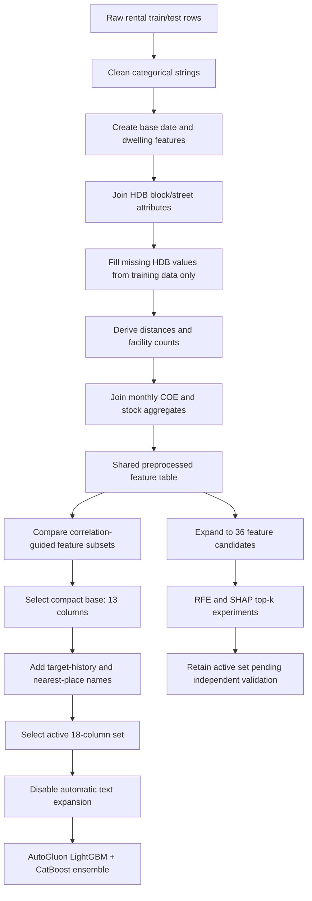

# Findings so far

## Selected listing-level feature set: `compact` + target and landmark features

`compact` remains the 13-column base subset from [Experiment 7](exp_7_autogluon_feature_subsets.ipynb), originally named `compact_no_coordinates`. The active reproducible representation is the 18-feature extension tested in [Experiment 9](exp_9_target_features.ipynb): `compact` plus the two target-history features, nearest MRT name, nearest tourist-attraction name, and nearest monument name. It uses a 24-month global lag and default/fixed model settings.

| Feature set | Features | RMSE | MAE | R² |
| --- | ---: | ---: | ---: | ---: |
| Archived 17-month global lag + town/flat-type mean + nearest MRT/attraction/monument names | 18 | **466.992** | **340.197** | **0.4948** |
| **`compact` + 24-month global lag + town/flat-type mean + nearest MRT/attraction/monument names** | **18** | **467.122** | **340.293** | **0.4945** |
| `compact` + 24-month town/flat-type lag + town/flat-type mean + nearest MRT/attraction/monument names | 18 | 468.986 | 342.419 | 0.4904 |
| `compact` (`compact_no_coordinates`) | 13 | 467.230 | 345.659 | 0.4942 |
| `compact_nonredundant` | 15 | 467.480 | 345.786 | 0.4937 |
| `full_preprocessed` | 31 | 467.507 | 346.647 | 0.4936 |
| `compact` + lag + town/flat-type mean | 15 | 467.622 | 339.720 | 0.4934 |
| `compact_plus_candidates` | 25 | 468.304 | 348.314 | 0.4919 |

These listing-level results use the common chronological split (117,988 fitting rows before **2024-05** and 32,012 validation rows from **2024-05** onward), with RMSE as the selection metric. Compare variants within the same notebook first: earlier compact-subset runs allowed AutoGluon's automatic text expansion, whereas the selected 18-feature run disables it. Small differences across those stages are therefore development comparisons, not pure one-variable ablations.

### Final `compact` columns

1. `TOWN`
2. `BLOCK`
3. `STREET`
4. `FLAT_TYPE`
5. `FLAT_MODEL`
6. `FLOOR_AREA_SQM`
7. `approval_date_num`
8. `approval_month`
9. `coe_quota_premium_mean`
10. `YEAR_COMPLETED`
11. `MAX_FLOOR`
12. `mrt_dist_nearest_km`
13. `mall_dist_nearest_km`

In particular, `compact` excludes the direct location coordinates (`LATITUDE`, `LONGITUDE`), while retaining the nearest-MRT and nearest-mall distances derived from them.

## Approaches tried after the original compact subset

### Target-history and nearest-place features

[Experiment 9](exp_9_target_features.ipynb) extends `compact` with the following features:

- `monthly_target_lag`: the overall mean `MONTHLY_RENT` from 24 months earlier; unavailable values fall back to the fitted global mean.
- `town_flat_type_target_lag`: the mean `MONTHLY_RENT` for the same `TOWN` + `FLAT_TYPE` from 24 months earlier. If that group-month is unavailable, it falls back to the leakage-safe historical town/flat-type mean.
- `town_flat_type_target_mean`: a leakage-safe historical mean rent for the same `TOWN` + `FLAT_TYPE`; training rows use strictly earlier months, while validation/test rows use only the labelled fit/train history.
- `nearest_mrt_name`: closest MRT station name, derived from the supplied MRT coordinates.
- `nearest_tourist_attraction_name`: closest attraction name from `TouristAttractions.geojson`.
- `nearest_monument_name`: closest national-monument name from `MonumentsGEOJSON.geojson`.

The active Experiment 9 comparison ran two otherwise-identical variants: one with the 24-month global lag and one with the 24-month town/flat-type lag. The **24-month global lag won** with **RMSE 467.122**, compared with **468.986** for the town/flat-type lag. It is therefore the preferred two-year-lag variant. The previously recorded 18-feature model achieved **RMSE 466.992**, an improvement of **0.238 RMSE** over the original 13-feature `compact` baseline; that result used an earlier 17-month global lag.

### AutoGluon configuration and text handling

AutoGluon is used as a training and weighted-ensemble wrapper, not for unrestricted model discovery. The selected configuration explicitly restricts the base models to:

- LightGBM (`GBM`); and
- CatBoost (`CAT`).

AutoGluon's second-level weighted ensemble learns global blend weights over these candidates. It is distinct from the input-dependent neural gates tested later. The selected run also uses the `ignore_text` preset, so columns such as `STREET` and `nearest_mrt_name` remain categorical and do not generate automatic text-special or n-gram features.

### Temporal Fusion Transformer (TFT)

[exp_9_dl.ipynb](exp_9_dl.ipynb) trains a global TFT on monthly mean rent for `TOWN × FLAT_TYPE` market segments. It scored **RMSE 258.453** on 1,340 observed *segment-months* over a 12-month holdout beginning in 2024-04. This is a segment-level forecast metric, not a per-listing metric, so it cannot be compared directly with the listing-level `compact` RMSE values.

[exp_9_tft_listing_hybrid.ipynb](exp_9_tft_listing_hybrid.ipynb) uses that TFT market forecast as a baseline and trains a listing-level residual model. Its earlier chronological holdout (training through 2024-03) recorded:

| Model | RMSE | MAE | R² |
| --- | ---: | ---: | ---: |
| Direct compact listing model | 471.209 | 349.000 | 0.489 |
| TFT + residual model | 499.791 | 391.545 | 0.425 |
| Blend with TFT weight 0.00 | 471.209 | 349.000 | 0.489 |

The validation-selected blend assigns zero weight to TFT, so TFT has not improved the listing model in this experiment.

### Hyperparameter tuning

[exp_7_autogluon_categorical_clean.ipynb](exp_7_autogluon_categorical_clean.ipynb) recorded the lowest common-split numerical score, **RMSE 466.432**, after 25 HPO trials each for LightGBM and CatBoost. However, the reported validation period was also supplied as AutoGluon's `tuning_data`. The score is therefore HPO-selected against that period and is not an untouched default-model estimate.

[exp_9_hpt_all_features.ipynb](exp_9_hpt_all_features.ipynb) contains HPO code for an earlier 16-feature configuration but does not retain a completed comparable validation result and omits the two landmark-name features. The active **467.122** result remains the preferred reproducible result with default/fixed model settings.

### Resale features and categorical encodings

The historical resale experiment added block, street, and town/flat-type median resale price per square metre plus 12-month resale growth, using only earlier transactions. These features contained useful marginal information but did not improve the selected model.

| Processing variant | RMSE | Difference from native 18-feature model |
| --- | ---: | ---: |
| Native 18-feature categoricals | **467.122** | — |
| + four historical resale features | 467.563 | +0.441 |
| Normal target encoding of all categoricals | 473.247 | +6.125 |
| Historical target encoding of all categoricals | 477.800 | +10.678 |

Native categorical handling is therefore retained. Normal target encoding did not read validation labels, but each fitting row contributed to its fitted category mean; historical encoding removed that self-inclusion but lost even more information.

## Automated feature-selection experiments

The candidate space was expanded to 36 variables and tested with permutation-importance recursive feature elimination (RFE) and SHAP top-*k* selection. These runs used a shorter 180-second AutoGluon budget, so they are comparable within this selection study rather than directly interchangeable with the 600-second selected-model run.

| Method | Selected/matched comparator | RMSE | Finding |
| --- | --- | ---: | --- |
| RFE | All 36 variables | **468.921** | Best RFE round retained everything. |
| RFE | Reduced 10-variable subset | 469.080 | Close, but no improvement from elimination. |
| SHAP | Top 18 | **467.841** | Best automated subset in the shortened protocol. |
| SHAP comparator | Manual 18-feature set | 468.272 | SHAP improved by 0.431 within this run. |

The RFE path was strongly non-monotonic: intermediate 28-, 22-, 17-, and 13-feature rounds were much worse, showing that greedy permutation-importance removal can discard interacting or time-sensitive variables too early. The SHAP top-18 result is promising, but the same outer validation period was used to select the subset. It is therefore a selection result rather than an untouched estimate and did not replace the active 18-feature representation.

PCA and truncated SVD were also tested as diagnostics. The first numeric principal component's target correlation changed from **0.654** in fitting to **0.306** in validation, while the second changed from **0.262** to **0.560**. No downstream PCA/SVD model RMSE was recorded, so the original interpretable variables were retained.

## Later model-family findings

The common-split experiments consistently favored a global boosted-tree ensemble over hard segmentation, standalone deep learning, random forests, and learned gates.

| Approach | Validation RMSE | Main conclusion |
| --- | ---: | --- |
| Default LightGBM + CatBoost AutoGluon ensemble | **467.122** | Preferred reproducible single-stage model. |
| Equal LightGBM/CatBoost blend in gating study | 468.740 | Beat the neural gate in the same run. |
| Equal blend of three deep experts | 471.168 | Best deep MoE result; averaging beat learned gating. |
| Neural LightGBM/CatBoost gate | 472.274 | Learned a CatBoost preference but underperformed the equal blend. |
| Block-to-town deep gate | 475.130 | Worse than the equal deep-expert blend. |
| Town-routed AutoGluon | 475.846 | Hard routing lost shared signal. |
| Flat-type-routed AutoGluon | 476.068 | Worse than its 471.448 global control. |
| Tuned global random forest | 479.319 | Better than other forests, still behind boosting. |
| Quantile LightGBM (`q = 0.60`) | 492.281 | Encouraged overforecasting but worsened RMSE. |
| TabTransformer | 495.853 | Standalone deep tabular model remained weaker. |
| FT-Transformer | 497.497 | Did not beat boosted trees. |

The quantile LightGBM reduced MAE from **356.438** to **343.087** relative to its ordinary-LightGBM comparator, confirming the intended upward bias, but RMSE worsened from **478.370** to **492.281**.

### Residual correction and selected two-layer architecture

Adding a first prediction as an ordinary second-layer feature severely degraded RMSE to **538.151**. Predicting residuals was safer only when the correction was strongly shrunk:

| Residual approach | RMSE | Change from matched Layer 1 (468.272) |
| --- | ---: | ---: |
| Weighted global AutoGluon residual | **468.057** | −0.215 |
| Weighted flat-type residual experts | 468.068 | −0.204 |
| Significant-residual gated specialist | 468.360 | +0.088 |
| Unweighted flat-type residual experts | 472.509 | +4.237 |
| Unweighted global residual | 473.949 | +5.678 |
| AutoGluon + AdaBoost residual | 497.420 | +29.148 |

The selected Metul production path recursively adds two weighted AutoGluon residual layers. The saved export records weights **0.505861** and **0.201996** and produces 50,000 predictions. Its exact two-layer validation RMSE is not retained in the saved notebook output, so it must not be invented. The verified **468.057** score belongs to the one-residual-layer variant.

## Current decision

For a **two-year lag**, use **`compact` plus `monthly_target_lag`, `town_flat_type_target_mean`, `nearest_mrt_name`, `nearest_tourist_attraction_name`, and `nearest_monument_name`**. Restrict AutoGluon to LightGBM and CatBoost and disable automatic text expansion. The global-lag variant is the better of the two active lag definitions, at listing-level RMSE **467.122** on the common 2024-05 chronological validation split.

Interpret the nearby lower scores carefully:

- **466.432** is the lowest common-split score, but it was selected through 50 HPO trials using the reported validation period as tuning data.
- **466.992** is an archived earlier 17-month-lag result.
- **467.122** is the best active result with default/fixed model settings and the explicit reproducible 24-month definition.
- The two-residual-layer export is the selected production architecture, but its exact validation RMSE is unavailable.

## Preprocessing and feature-selection flow

### Step-by-step details

1. **Load inputs.** Read the rental train/test files and the HDB block, MRT, mall, school, COE, and stock auxiliary datasets.
2. **Standardise categorical values.** For rental and HDB lookup categories, lowercase values; trim and collapse whitespace; and convert hyphen, underscore, and slash separators to spaces. This makes lookup keys and category values consistent without restricting unseen test values.
3. **Add base features.** Parse `RENT_APPROVAL_DATE` into `approval_year`, `approval_month`, and the sequential `approval_date_num`; derive `lease_age` and numeric `flat_type_num`. Remove `FURNISHED` and `FEE`, which were constant in the supplied training data.
4. **Add HDB attributes.** Match HDB data by cleaned block/street keys to obtain `LATITUDE`, `LONGITUDE`, `MAX_FLOOR`, `YEAR_COMPLETED`, and `REGION`.
5. **Handle unmatched HDB records without leakage.** When an HDB value is missing, fill it in this order: training-set town/street median, training-set town median, then training-set global median. Fill `REGION` with the training-set town mode, then global mode. The preprocessor is fitted only on the training partition; validation and test rows are transform-only.
6. **Create spatial features.** Convert latitude/longitude to approximate kilometre coordinates and calculate each block/street location's nearest distance plus counts within 1 km and 2 km for MRT stations, malls, and schools.
7. **Add monthly external-data features.** Aggregate COE quota premium and bids by year/month, and stock close and volume by year/month; then join these aggregates using the approval year and month.
8. **Select the active columns.** Compare candidate subsets on chronological validation. The current model receives the 13 `compact` columns plus the five target-history/nearest-place features documented above.
9. **Control AutoGluon feature generation.** Use only `GBM` and `CAT` base models and apply `ignore_text` so the explicitly selected columns are not expanded into text-special or n-gram features.
10. **Treat automated selection as provisional.** RFE did not improve on the full candidate pool, while SHAP top-18 improved within its shortened selection run but reused the outer validation period for selection.

## Reproducibility notes

- The feature subset experiment is in [exp_7_autogluon_feature_subsets.ipynb](exp_7_autogluon_feature_subsets.ipynb).
- The shared, leakage-aware preprocessing implementation is in [preprocessing.py](preprocessing.py).
- Automated selection is recorded in [exp_16_autogluon_rfe.ipynb](exp_16_autogluon_rfe.ipynb) and [exp_16_shap_feature_selection.ipynb](exp_16_shap_feature_selection.ipynb).
- Residual stacking is recorded in [exp_14_autogluon_autogluon_residual_stack.ipynb](exp_14_autogluon_autogluon_residual_stack.ipynb), [exp_15_significant_residual_gate.ipynb](exp_15_significant_residual_gate.ipynb), and [exp_15_flat_type_segmented_residual_autogluon.ipynb](exp_15_flat_type_segmented_residual_autogluon.ipynb).
- For final test predictions, fit a fresh preprocessor on all labelled training rows, transform the test rows with that fitted instance, build the five additional features from their permitted sources, then train the selected 18-column model on the full training data.
