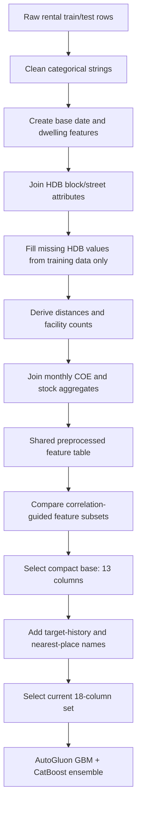

# Findings so far

## Current best listing-level feature set: `compact` + target and landmark features

`compact` remains the 13-column base subset from [Experiment 7](exp_7_autogluon_feature_subsets.ipynb), originally named `compact_no_coordinates`. The current best result on the same chronological validation split is the 18-feature extension tested in [Experiment 9](exp_9_target_features.ipynb): `compact` plus the two target-history features, nearest MRT name, nearest tourist-attraction name, and nearest monument name.

| Feature set | Features | RMSE | MAE | R² |
| --- | ---: | ---: | ---: | ---: |
| **`compact` + lag + town/flat-type mean + nearest MRT/attraction/monument names** | **18** | **466.992** | **340.197** | **0.4948** |
| `compact` + **24-month global lag** + town/flat-type mean + nearest MRT/attraction/monument names | 18 | 467.122 | 340.293 | 0.4945 |
| `compact` + 24-month town/flat-type lag + town/flat-type mean + nearest MRT/attraction/monument names | 18 | 468.986 | 342.419 | 0.4904 |
| `compact` (`compact_no_coordinates`) | 13 | 467.230 | 345.659 | 0.4942 |
| `compact_nonredundant` | 15 | 467.480 | 345.786 | 0.4937 |
| `full_preprocessed` | 31 | 467.507 | 346.647 | 0.4936 |
| `compact` + lag + town/flat-type mean | 15 | 467.622 | 339.720 | 0.4934 |
| `compact_plus_candidates` | 25 | 468.304 | 348.314 | 0.4919 |

These listing-level comparisons use an 80/20 chronological split (training before **2024-05**, validation from **2024-05** onward), with RMSE as the selection metric. Each candidate uses the same untuned AutoGluon LightGBM + CatBoost ensemble. Select features from this validation result rather than from a modified-test proxy score.

### Final `compact` columns

1. `TOWN`
2. `BLOCK`
3. `STREET`
4. `FLAT_TYPE`
5. `FLAT_MODEL`
6. `FLOOR_AREA_SQM`
7. `approval_date_num`
8. `approval_month`
9. `coe_quota_premium_mean`
10. `YEAR_COMPLETED`
11. `MAX_FLOOR`
12. `mrt_dist_nearest_km`
13. `mall_dist_nearest_km`

In particular, `compact` excludes the direct location coordinates (`LATITUDE`, `LONGITUDE`), while retaining the nearest-MRT and nearest-mall distances derived from them.

## Approaches tried after the original compact subset

### Target-history and nearest-place features

[Experiment 9](exp_9_target_features.ipynb) extends `compact` with the following features:

- `monthly_target_lag`: the overall mean `MONTHLY_RENT` from 24 months earlier; unavailable values fall back to the fitted global mean.
- `town_flat_type_target_lag`: the mean `MONTHLY_RENT` for the same `TOWN` + `FLAT_TYPE` from 24 months earlier. If that group-month is unavailable, it falls back to the leakage-safe historical town/flat-type mean.
- `town_flat_type_target_mean`: a leakage-safe historical mean rent for the same `TOWN` + `FLAT_TYPE`; training rows use strictly earlier months, while validation/test rows use only the labelled fit/train history.
- `nearest_mrt_name`: closest MRT station name, derived from the supplied MRT coordinates.
- `nearest_tourist_attraction_name`: closest attraction name from `TouristAttractions.geojson`.
- `nearest_monument_name`: closest national-monument name from `MonumentsGEOJSON.geojson`.

The active Experiment 9 comparison ran two otherwise-identical variants: one with the 24-month global lag and one with the 24-month town/flat-type lag. The **24-month global lag won** with **RMSE 467.122**, compared with **468.986** for the town/flat-type lag. It is therefore the preferred two-year-lag variant. The previously recorded 18-feature model achieved **RMSE 466.992**, an improvement of **0.238 RMSE** over the original 13-feature `compact` baseline; that result used an earlier 17-month global lag.

### Temporal Fusion Transformer (TFT)

[exp_9_dl.ipynb](exp_9_dl.ipynb) trains a global TFT on monthly mean rent for `TOWN × FLAT_TYPE` market segments. It scored **RMSE 258.453** on 1,340 observed *segment-months* over a 12-month holdout beginning in 2024-04. This is a segment-level forecast metric, not a per-listing metric, so it cannot be compared directly with the listing-level `compact` RMSE values.

[exp_9_tft_listing_hybrid.ipynb](exp_9_tft_listing_hybrid.ipynb) uses that TFT market forecast as a baseline and trains a listing-level residual model. Its earlier chronological holdout (training through 2024-03) recorded:

| Model | RMSE | MAE | R² |
| --- | ---: | ---: | ---: |
| Direct compact listing model | 471.209 | 349.000 | 0.489 |
| TFT + residual model | 499.791 | 391.545 | 0.425 |
| Blend with TFT weight 0.00 | 471.209 | 349.000 | 0.489 |

The validation-selected blend assigns zero weight to TFT, so TFT has not improved the listing model in this experiment.

### Hyperparameter tuning

[exp_9_hpt_all_features.ipynb](exp_9_hpt_all_features.ipynb) contains HPO for the prior 16-feature all-feature configuration (compact, lag, town/flat-type mean, and nearest MRT name). It tunes LightGBM and CatBoost, including tree/iteration settings. No completed validation RMSE is currently recorded in that notebook, and it does not yet include the two landmark-name features; it is therefore not used for the current selection.

## Current decision

For a **two-year lag**, use **`compact` plus `monthly_target_lag`, `town_flat_type_target_mean`, `nearest_mrt_name`, `nearest_tourist_attraction_name`, and `nearest_monument_name`**: the global-lag variant is the better of the two, at listing-level RMSE **467.122** on the common 2024-05 chronological validation split.

Across every recorded configuration, the older 17-month global-lag version of this same 18-feature set remains the numerical best at **RMSE 466.992**. Keep it as the overall leader unless the project intentionally standardises on a two-year lag.

## Preprocessing and feature-selection flow

### Step-by-step details

1. **Load inputs.** Read the rental train/test files and the HDB block, MRT, mall, school, COE, and stock auxiliary datasets.
2. **Standardise categorical values.** For rental and HDB lookup categories, lowercase values; trim and collapse whitespace; and convert hyphen, underscore, and slash separators to spaces. This makes lookup keys and category values consistent without restricting unseen test values.
3. **Add base features.** Parse `RENT_APPROVAL_DATE` into `approval_year`, `approval_month`, and the sequential `approval_date_num`; derive `lease_age` and numeric `flat_type_num`. Remove `FURNISHED` and `FEE`, which were constant in the supplied training data.
4. **Add HDB attributes.** Match HDB data by cleaned block/street keys to obtain `LATITUDE`, `LONGITUDE`, `MAX_FLOOR`, `YEAR_COMPLETED`, and `REGION`.
5. **Handle unmatched HDB records without leakage.** When an HDB value is missing, fill it in this order: training-set town/street median, training-set town median, then training-set global median. Fill `REGION` with the training-set town mode, then global mode. The preprocessor is fitted only on the training partition; validation and test rows are transform-only.
6. **Create spatial features.** Convert latitude/longitude to approximate kilometre coordinates and calculate each block/street location's nearest distance plus counts within 1 km and 2 km for MRT stations, malls, and schools.
7. **Add monthly external-data features.** Aggregate COE quota premium and bids by year/month, and stock close and volume by year/month; then join these aggregates using the approval year and month.
8. **Select the final columns.** Compare candidate subsets on chronological validation. The current model receives the 13 `compact` columns plus the five target-history/nearest-place features documented above.

## Reproducibility notes

- The feature subset experiment is in [exp_7_autogluon_feature_subsets.ipynb](exp_7_autogluon_feature_subsets.ipynb).
- The shared, leakage-aware preprocessing implementation is in [preprocessing.py](preprocessing.py).
- For final test predictions, fit a fresh preprocessor on all labelled training rows, transform the test rows with that fitted instance, build the five additional features from their permitted sources, then train the selected 18-column model on the full training data.
