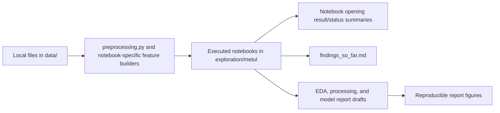

# Metul report evidence and reproducibility guide

This folder consolidates Metul's executed experiments into three research-paper sections. The report text is derived from saved notebook outputs in [`exploration/metul`](../../exploration/metul), not from proposed or unexecuted configurations. The opening markdown cell of every experiment notebook from Experiment 2 onward now records its executed result, finding, or execution status, including the evaluation unit and any protocol limitation.

## Report sections

| Document | Paper content | Status |
| --- | --- | --- |
| [`eda.md`](eda.md) | Temporal drift, property and geographic structure, categorical coverage, linear and nonlinear associations, dimensionality analysis, resale-market evidence, outliers, and residual patterns | Complete draft |
| [`data_processing.md`](data_processing.md) | Cleaning, joins and fitted missing-value handling, leakage controls, feature engineering, categorical representation, feature-subset comparisons, and automated feature selection | Complete draft |
| [`model_experiments.md`](model_experiments.md) | Boosting, AutoGluon ensembles, time-series models, deep learning, segmentation, random forests, mixture-of-experts, asymmetric loss, and residual stacks | Complete draft |

The report figures are stored in [`figures/`](figures/). They are regenerated by [`generate_eda_figures.py`](generate_eda_figures.py), [`generate_data_processing_figures.py`](generate_data_processing_figures.py), and [`generate_model_experiment_figures.py`](generate_model_experiment_figures.py).

## Data provenance and use

All experiment inputs are local files under [`data/`](../../data). The shared loader in [`preprocessing.py`](../../exploration/metul/preprocessing.py) reads the primary rental files and the project auxiliary CSVs listed below. The landmark and resale files were added later as candidate external features. The repository does not record a complete publisher citation for every supplied auxiliary file, so this table states the reproducible repository source and modelling role without inventing external provenance.

| Repository input | Information used | How it enters the experiments |
| --- | --- | --- |
| [`train.csv`](../../data/train.csv) | Approval month, town, block, street, flat type/model, floor area, lease commencement, and `MONTHLY_RENT` | Labelled base table; the only source of model targets and fitted target-history statistics |
| [`test.csv`](../../data/test.csv) | The same listing attributes without `MONTHLY_RENT` | Competition prediction rows; transformed with objects fitted on labelled training data |
| [`sg-hdb-block.csv`](../../data/auxiliary/sg-hdb-block.csv) | Block coordinates, maximum floor, completion year, subzone, planning area, and region | Joined using cleaned `BLOCK + STREET` keys; supplies building and geographic attributes |
| [`sg-mrt-stations.csv`](../../data/auxiliary/sg-mrt-stations.csv) | MRT station names and coordinates | Nearest-MRT distance, nearby-station counts, and nearest MRT name |
| [`sg-shopping-malls.csv`](../../data/auxiliary/sg-shopping-malls.csv) | Mall names and coordinates | Nearest-mall distance and nearby-mall counts |
| [`sg-schools.csv`](../../data/auxiliary/sg-schools.csv) | School names, types, and coordinates | Nearest-school distance and nearby-school counts in the broad candidate table |
| [`sg-coe-prices.csv`](../../data/auxiliary/sg-coe-prices.csv) | Monthly quota premiums, quotas, and bids | Aggregated by year/month and joined to the rental approval month |
| [`sg-stock-prices.csv`](../../data/auxiliary/sg-stock-prices.csv) | Daily market prices and volume | Aggregated to monthly market variables and joined by approval month |
| [`TouristAttractions.geojson`](../../data/possible_additional_features/TouristAttractions.geojson) | Attraction names and coordinates | Source of `nearest_tourist_attraction_name` |
| [`MonumentsGEOJSON.geojson`](../../data/possible_additional_features/MonumentsGEOJSON.geojson) | National-monument names and mapped locations | Source of `nearest_monument_name` |
| [`ResaleflatpricesbasedonregistrationdatefromJan2017onwards.csv`](../../data/possible_additional_features/ResaleflatpricesbasedonregistrationdatefromJan2017onwards.csv) | HDB resale month, address, flat attributes, floor area, and resale price | Earlier-transaction-only block, street, and town/flat-type resale-price-per-square-metre statistics plus 12-month growth |

### Derived data and leakage controls

- Rental categories are lowercased, trimmed, whitespace-normalized, and separator-normalized before matching. This reduced `STREET` from 1,146 raw labels to 576 and `FLAT_TYPE` from 11 labels to 6.
- The HDB lookup uses cleaned `BLOCK + STREET`. Missing numeric attributes are filled from statistics fitted on the current training partition: town/street median, then town median, then global median. Region uses fitted town and global modes.
- Date variables come from `RENT_APPROVAL_DATE`; lease age comes from `LEASE_COMMENCE_DATE`; building completion and height come from the HDB lookup.
- Facility distances and counts are calculated from property coordinates and the supplied MRT, mall, and school coordinates.
- Monthly COE and stock aggregates are joined by approval year and month. They do not use the rent target.
- `monthly_target_lag` and `town_flat_type_target_mean` are derived only from permitted labelled history. Validation and test rows never contribute targets to fitted mappings. Training historical means exclude the row's current month.
- Historical resale features use only resale transactions earlier than the rental record being transformed.
- Validation and test frames are transform-only. The preprocessor and target-derived mappings are fitted again on all labelled rows only when producing final test predictions.

## Evidence flow

When values conflict, use the saved executed notebook output first. The notebook opening summary provides its interpretation and protocol. [`findings_so_far.md`](../../exploration/metul/findings_so_far.md) additionally preserves explicitly labelled results from earlier notebook states, such as the archived 17-month-lag run. Scores without a retained completed evaluation are not reconstructed or invented.

## Experiment coverage

| Experiments | Main question | Consolidated report destination |
| --- | --- | --- |
| 2–4 | Broad joins, LightGBM tuning, difficult subgroups, compact inputs, and the first time/structure decomposition | Data processing and model history; older protocols are labelled separately |
| 5–6 | AutoGluon baseline and aggregate time-series/listing-residual hybrids | Model experiments |
| 7 | Categorical cleaning, feature-subset selection, outlier/coverage audit, and explicit trend validation | All three report sections |
| 9 | Target-history and landmark features, TFT market forecasting, HPO attempt, and TFT/listing hybrid | Data processing and model experiments |
| 10 | Neural gates, diverse boosted experts, deep tabular models, and town-average time-series modelling | Model experiments |
| 11 | Flat-type and town segmentation | Model experiments |
| 12 | Random forests, quantile overforecasting, and tree/deep mixture-of-experts | Model experiments |
| 13 | PCA/SVD and nonlinear association analysis, tuned random forest, neural gating, and prediction-as-feature stacking | EDA and model experiments |
| 14 | Historical resale features, categorical encodings, AdaBoost residuals, and AutoGluon residual layers | Data processing and model experiments |
| 15 | Residual profiling, high-residual specialists, and segmented residual predictors | EDA and model experiments |
| 16 | Permutation-importance RFE and SHAP top-*k* selection | Data processing and model experiments |
| 17 | Exploratory two-residual-layer HPO | Excluded from the current ranking; it does not replace the retained default/fixed-setting conclusion |

## Validation and metric rules

The principal listing-level comparison uses the common chronological P1 split:

- fit rows: approval dates before **May 2024** (117,988 listings);
- validation rows: approval dates from **May 2024 onward** (32,012 listings); and
- selection metric: listing-level RMSE, with MAE and R² reported where retained.

Not every early or specialized notebook uses P1. Fixed random/older holdouts, rolling-origin folds, calendar-year backtests, property-group months, and `TOWN × FLAT_TYPE` segment-months remain useful evidence, but their RMSE values are labelled as alternate protocols and are not inserted into the same ranking. Aggregate time-series RMSE must not be compared numerically with listing-level RMSE.

HPO-selected and default/fixed-setting results are also kept distinct. In particular, RMSE 466.432 used the reported validation period as AutoGluon tuning data, whereas RMSE 467.122 is the active default/fixed-setting result for the selected two-year-lag feature definition.

## Current selected configuration

The active listing representation contains the 13-column `compact` base selected in Experiment 7:

`TOWN`, `BLOCK`, `STREET`, `FLAT_TYPE`, `FLAT_MODEL`, `FLOOR_AREA_SQM`, `approval_date_num`, `approval_month`, `coe_quota_premium_mean`, `YEAR_COMPLETED`, `MAX_FLOOR`, `mrt_dist_nearest_km`, and `mall_dist_nearest_km`.

Experiment 9 adds five variables:

`monthly_target_lag` using a 24-month global lag, `town_flat_type_target_mean`, `nearest_mrt_name`, `nearest_tourist_attraction_name`, and `nearest_monument_name`.

The selected single-stage model is an AutoGluon weighted ensemble restricted to LightGBM and CatBoost. The `ignore_text` preset is used so string columns remain categorical instead of generating text-special and n-gram features. This configuration scored listing-level P1 RMSE **467.122**, MAE **340.293**, and R² **0.4945**.

Important nearby results are interpreted as follows:

- **466.432:** lowest common-split number, but HPO-selected on the reported validation period;
- **466.992:** archived 17-month global-lag result from an earlier notebook state;
- **467.122:** best active, reproducible 24-month result with default/fixed model settings;
- **468.057:** verified one-residual-layer result within its matched later protocol, improving its 468.272 control; and
- two weighted AutoGluon residual layers: selected final export architecture, with weights 0.505861 and 0.201996, but no retained exact two-layer validation RMSE.

## Reproducing or extending the report

1. Start with the local inputs documented above.
2. Use [`preprocessing.py`](../../exploration/metul/preprocessing.py) for the shared fitted transformations.
3. Use each notebook's first markdown cell to identify its saved outcome and evaluation protocol before quoting a result.
4. Use the evidence-traceability section at the end of each report draft to locate the supporting notebooks.
5. Regenerate figures with the matching script in this folder after changing any reported values.
6. Keep new P1 listing scores separate from HPO-selected or alternate-unit results unless their split, target unit, and tuning treatment are identical.
