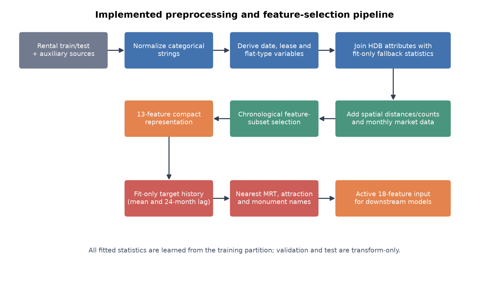
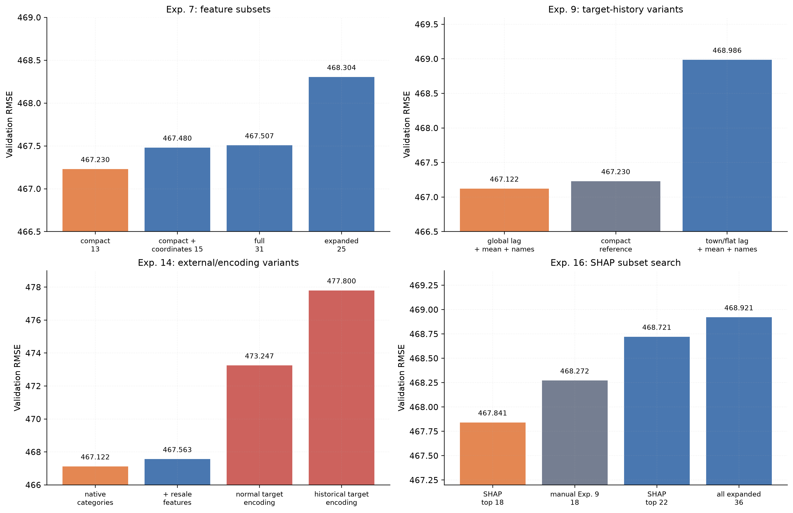

# Data Preprocessing, Cleaning, and Feature Selection

## A. Scope and comparison protocol

This section documents the preprocessing and feature-selection approaches implemented from the early joined-data experiments through Experiment 16. The principal comparison uses the common chronological split: 117,988 rows before May 2024 for fitting and 32,012 rows from May 2024 onward for validation. Root mean squared error (RMSE) is the primary metric. Lower values are better.

Results are compared directly only when they were produced inside the same controlled experiment. Cross-experiment comparisons are labelled because AutoGluon time limits, text handling, or tuning procedures changed during development. Random-fold results and older holdouts are reported separately from the common chronological split.

## B. Implemented preprocessing pipeline

The shared implementation is contained in [`preprocessing.py`](../../exploration/metul/preprocessing.py). A `RentalPreprocessor` is fitted on the permitted training partition and reused without refitting for validation or test rows. Figure 1 summarizes the complete path from raw inputs to the active modelling representation.

**Fig. 1.** Shared preprocessing and feature-selection flow. Only training labels and training-derived fallback statistics are fitted; validation and test rows are transform-only.

### 1. Categorical normalization

Rental and HDB categorical strings are lowercased, trimmed, whitespace-normalized, and have hyphen, underscore, and slash separators replaced by spaces. This folds equivalent values such as `4-room` and `4 room` into one category. In the training data, normalization reduced `STREET` from 1,146 to 576 values and `FLAT_TYPE` from 11 to 6. It also removed all six test rows whose street spelling would otherwise have been unseen. Missing category values remain missing, and unseen test categories are retained rather than forced into a fitted vocabulary.

### 2. Base date and dwelling variables

`RENT_APPROVAL_DATE` is decomposed into `approval_year`, `approval_month`, and the sequential `approval_date_num = 12 × year + month`. Lease age is calculated as approval year minus lease commencement year, and flat type is additionally represented by an ordered numeric value. `FURNISHED` and `FEE` are removed because they are constant in training (`yes` and zero, respectively).

### 3. HDB attribute join and missing-value fallbacks

Cleaned block and street values join the rental table to the HDB block data. The join supplies latitude, longitude, maximum floor, year completed, and region. Exact block/street lookup entries are frozen during fitting. If a numeric HDB attribute is unavailable, it is filled in the following order:

1. median for the fitted town–street group;
2. median for the fitted town; and
3. fitted global median.

Region uses the fitted town mode and then the fitted global mode. Validation and test records never contribute to these statistics.

### 4. Spatial and external monthly features

Latitude and longitude are converted to approximate kilometre coordinates. KD-tree queries calculate the nearest distance and counts within 1 km and 2 km for MRT stations, malls, and schools. COE quota premiums and bid counts are averaged by calendar month, while stock close and volume are aggregated by month before joining on approval year and month.

The outlier audit identified 130 floor-area values and 752 target values outside IQR fences. These rows were retained because the values can represent legitimate large flats or expensive rentals, and blanket deletion would narrow the supported prediction range.

## C. Categorical representation

The experiments considered four ways to represent categoricals:

- **Native categories.** String columns are passed to the tree learners as categorical variables. This is the active approach.
- **One-hot encoding.** The early `feature_relations` benchmark found native LightGBM encoding slightly better in six of seven configurations while using substantially fewer columns. For example, town + region + block obtained random-fold RMSE 481.89 with native encoding versus 482.09 with one-hot encoding. These are exploratory random-fold scores, not final chronological results.
- **Frequency encoding.** A frequency-encoding path was tried for the high-cardinality AdaBoost work. The current project artifacts do not retain a standalone, comparable chronological validation table for this variant, so no RMSE is assigned to it here.
- **Target encoding.** Experiment 14 replaced all eight categorical columns in the 18-feature set with their target means. Both the ordinary and historical versions underperformed native categories, as shown in Table IV.

From Experiment 9 onward, AutoGluon used the `ignore_text` preset. This prevented automatic text-special and n-gram columns from being created from fields such as `STREET` and `nearest_mrt_name`; the model therefore received only the explicitly designed inputs. Earlier Experiment 7 subset runs allowed AutoGluon's automatic text expansion, so small cross-experiment RMSE differences should not be interpreted as pure feature ablations.

## D. Initial broad preprocessing and categorical cleaning

Experiment 5 trained AutoGluon on the broad joined feature table. On the common chronological split, the weighted ensemble achieved RMSE 469.234, MAE 348.510, and R² 0.4899. Experiment 7 introduced consistent category cleaning, removed the two constant inputs, and ran 25 HPO trials for each of LightGBM and CatBoost; its broad-feature ensemble achieved RMSE 466.432, MAE 345.732, and R² 0.4960. Because the reported validation period was also supplied as HPO `tuning_data`, this is an HPO-selected score rather than a default-setting feature comparison.

**Table I. Broad preprocessing progression on the common chronological split**

| Experiment | Processing state | Input columns | RMSE | MAE | R² |
| --- | --- | ---: | ---: | ---: | ---: |
| Exp. 5 | Broad shared preprocessor | 33 | 469.234 | 348.510 | 0.4899 |
| Exp. 7 | Category normalization, constant-column removal, and 50 HPO trials | 31 | **466.432** | **345.732** | **0.4960** |

This table records the development progression rather than a strict one-variable ablation because the AutoGluon searches were not identical. Experiment 9, at RMSE 467.122, remains the best active result obtained without explicit model HPO.

## E. Experiment 7 feature-subset selection

Experiment 7 compared four subsets with the same LightGBM + CatBoost AutoGluon setup. The best subset was `compact_no_coordinates`, subsequently shortened to `compact`. It contains 13 variables:

`TOWN`, `BLOCK`, `STREET`, `FLAT_TYPE`, `FLAT_MODEL`, `FLOOR_AREA_SQM`, `approval_date_num`, `approval_month`, `coe_quota_premium_mean`, `YEAR_COMPLETED`, `MAX_FLOOR`, `mrt_dist_nearest_km`, and `mall_dist_nearest_km`.

**Table II. Controlled Experiment 7 feature-subset comparison**

| Feature subset | Features | RMSE | MAE | R² |
| --- | ---: | ---: | ---: | ---: |
| **`compact` (`compact_no_coordinates`)** | **13** | **467.230** | **345.659** | **0.4942** |
| `compact_nonredundant` | 15 | 467.480 | 345.786 | 0.4937 |
| Full preprocessed table | 31 | 467.507 | 346.647 | 0.4936 |
| `compact_plus_candidates` | 25 | 468.304 | 348.314 | 0.4919 |

The 15-feature subset differs from `compact` by retaining raw latitude and longitude. The 25-feature candidate set additionally includes region, stock aggregates, facility counts, and school proximity variables. Neither expansion improved validation. This result established that direct coordinates and broad groups of weak auxiliary features were unnecessary for the preferred representation.

## F. Leakage-safe target history and nearest-place features

Experiment 9 extended `compact` with target history and named geographic context. Its active 18 inputs add:

- `monthly_target_lag`: overall mean rent exactly 24 months earlier;
- `town_flat_type_target_mean`: historical mean rent for the same cleaned town and flat type;
- `nearest_mrt_name`;
- `nearest_tourist_attraction_name`; and
- `nearest_monument_name`.

Training rows receive a town × flat-type mean calculated from strictly earlier months. The earliest group rows fall back to the global mean from earlier months. Validation features are fitted only on the pre-May-2024 history, and final test features are fitted only on the complete labelled training data. The global lag similarly falls back to an available prior-only mean for training rows and to the fitted training mean when transforming future rows.

The alternative `town_flat_type_target_lag` uses the mean for the same town and flat type exactly 24 months earlier, falling back to the fitted historical group mean when unavailable.

**Table III. Experiment 9 feature-engineering results**

| Representation | Features | RMSE | MAE | R² | Evidence status |
| --- | ---: | ---: | ---: | ---: | --- |
| 17-month global lag + historical mean + three nearest-place names | 18 | **466.992** | 340.197 | 0.4948 | Archived in `findings_so_far.md`; prior notebook state |
| 24-month global lag + historical mean + three nearest-place names | 18 | **467.122** | 340.293 | 0.4945 | Active executed notebook |
| `compact` reference | 13 | 467.230 | 345.659 | 0.4942 | Experiment 7 reference |
| Global lag + historical mean, without the three landmark names | 15 | 467.622 | 339.720 | 0.4934 | Archived in `findings_so_far.md` |
| 24-month town × flat-type lag + historical mean + names | 18 | 468.986 | 342.419 | 0.4904 | Active executed notebook |

The active two-year experiment therefore preferred the global lag to the group-specific lag by 1.864 RMSE. Adding the historical features and place names produced only a small RMSE change relative to `compact`, although MAE improved by approximately SGD 5.37. The previously recorded 17-month lag remains the best single-layer feature result, but the active downstream notebooks standardize on the 24-month definition.

## G. Historical resale variables and categorical target encoding

Experiment 14 appended four prior-only resale variables to the 18-feature set: median resale price per square metre at block, street, and town × flat-type levels, plus 12-month town × flat-type resale growth. Despite their positive marginal correlations, the combined feature set slightly worsened validation RMSE.

The same experiment family compared native categoricals with two all-category target encoders. The ordinary encoder learned category means from the complete outer fitting partition and mapped validation from those fitted values; therefore it did not read validation targets, but each fitting row's own target contributed to its encoded training category mean. The historical encoder avoided that self-inclusion by using earlier data. Both lost information relative to allowing LightGBM and CatBoost to model the original categories directly.

**Table IV. Experiment 14 processing alternatives**

| Variant | Features | RMSE | Difference from native |
| --- | ---: | ---: | ---: |
| Native 18-feature categoricals | 18 | **467.122** | — |
| Native features + four historical resale variables | 22 | 467.563 | +0.441 |
| Normal target encoding for all categoricals | 18 numeric | 473.247 | +6.125 |
| Historical target encoding for all categoricals | 18 numeric | 477.800 | +10.678 |

The target-encoding RMSE values are preserved in the corresponding saved AutoGluon predictor leaderboards under [`ag_exp_14_target_encoding`](../../exploration/metul/ag_exp_14_target_encoding/).

**Fig. 2.** Validation RMSE within four controlled experiment families. Because training budgets and text handling changed between experiment families, bar heights should be compared within each panel rather than treated as one global ranking.

## H. Dimensionality transformations

Experiment 13 examined PCA on standardized numeric inputs and truncated SVD on the complete encoded feature matrix. The leading components were not temporally stable: for example, the first numeric principal component's target correlation changed from 0.654 in fitting to 0.306 in validation, while the second changed from 0.262 to 0.560. No downstream model RMSE was recorded for a PCA- or SVD-replaced feature set. The transformation was therefore treated as diagnostic analysis and was not adopted into the production pipeline.

## I. Automated feature selection in Experiment 16

Experiment 16 expanded the candidate space to 36 variables and applied two automated strategies. These runs used a 180-second AutoGluon budget and an internal AutoGluon holdout before evaluation on the outer May-2024-forward period. Their scores are comparable within Experiment 16, but not exact replications of the 600-second Experiment 9 setup.

### 1. Recursive feature elimination

Permutation-importance RFE did not identify a better reduced subset. The outer-period selection retained all 36 variables at RMSE 468.921. A later 10-feature round came close at RMSE 469.080, while intermediate elimination rounds were unstable and substantially worse.

**Table V. Experiment 16 recursive feature-elimination path**

| RFE features | RMSE | MAE | R² |
| ---: | ---: | ---: | ---: |
| **36** | **468.921** | 344.701 | 0.4906 |
| 10 | 469.080 | 342.016 | 0.4902 |
| 28 | 483.652 | 367.247 | 0.4581 |
| 13 | 511.897 | 391.027 | 0.3929 |
| 22 | 512.979 | 391.730 | 0.3904 |
| 17 | 515.646 | 394.463 | 0.3840 |

The non-monotonic path shows that greedy elimination based on one fitted model's permutation importance can remove interacting or time-sensitive features too early.

### 2. SHAP-guided selection

SHAP ranking was more successful within the same shortened selection protocol. The top-18 subset achieved RMSE 467.841, improving on the manual Experiment 9 set's 468.272 in that run. Larger subsets added little, while top-10 and top-14 variants removed too much signal.

**Table VI. Experiment 16 SHAP-guided subset comparison**

| SHAP/manual subset | Features | RMSE | MAE | R² |
| --- | ---: | ---: | ---: | ---: |
| **SHAP top 18** | **18** | **467.841** | **339.549** | **0.4929** |
| Manual Experiment 9 set | 18 | 468.272 | 340.987 | 0.4920 |
| SHAP top 22 | 22 | 468.721 | 341.248 | 0.4910 |
| All expanded features | 36 | 468.921 | 344.701 | 0.4906 |
| SHAP top 28 | 28 | 469.028 | 344.932 | 0.4903 |
| SHAP top 14 | 14 | 472.997 | 344.522 | 0.4817 |
| SHAP top 10 | 10 | 473.274 | 344.389 | 0.4811 |

The selected SHAP inputs were the historical town × flat-type mean, approval date number, flat type, raw approval date, floor area, nearest-MRT distance, street, COE premium, latitude, lease commencement, numeric flat type, approval year, nearest monument name, lease age, maximum floor, block, flat model, and year completed. This subset excluded the 24-month lag, town, mall distance, nearest MRT name, nearest attraction name, and longitude. Because this was a feature-selection result on the same outer period used to choose the subset, it was not treated as an untouched generalization estimate and did not replace the 18-feature Experiment 9 representation used by the best residual-stack model.

## J. Earlier feature-selection results with different protocols

Before the common chronological split was standardized, Experiment 2 obtained RMSE 478.603 from a broad joined LightGBM setup. Experiment 4 used correlation-guided feature selection and Optuna-tuned LightGBM, obtaining RMSE 481.076, MAE 362.906, and R² 0.5887 on its earlier holdout. The `feature_relations` notebook also reported random five-fold RMSE 500.67 for a seven-feature baseline and approximately 479.54 after geographic expansion and tuning. These values document the search path but must not be ranked against Tables I–IV.

## K. Selected processing configuration

The processing evidence supports the following configuration for the final modelling experiments:

1. use normalized categorical strings and retain native categories;
2. derive date variables and remove constant columns;
3. join HDB attributes with fitted hierarchical fallbacks;
4. retain the compact structural, geographic, COE, and proximity variables;
5. add the leakage-safe town × flat-type historical mean and 24-month global mean lag;
6. add nearest MRT, tourist-attraction, and monument names; and
7. disable automatic text feature generation so the model consumes the intended 18 inputs.

The resulting feature set is not the lowest RMSE ever recorded in isolation—the archived 17-month lag scored 466.992—but it is the active, reproducible two-year definition used by the later experiments and by the current best two-residual-layer model.

## L. Evidence traceability

- [`preprocessing.py`](../../exploration/metul/preprocessing.py): shared cleaning, fitted HDB fallbacks, spatial variables, and monthly external joins;
- [`exp_7_feature_cleaning_exploration.ipynb`](../../exploration/metul/exp_7_feature_cleaning_exploration.ipynb): category normalization, coverage, and outlier audit;
- [`exp_7_autogluon_feature_subsets.ipynb`](../../exploration/metul/exp_7_autogluon_feature_subsets.ipynb): controlled subset comparison;
- [`exp_9_target_features.ipynb`](../../exploration/metul/exp_9_target_features.ipynb): target-history and nearest-place feature comparison;
- [`findings_so_far.md`](../../exploration/metul/findings_so_far.md): archived Experiment 9 results from earlier notebook states;
- [`exp_14_resale_features_lgbm.ipynb`](../../exploration/metul/exp_14_resale_features_lgbm.ipynb): historical resale feature comparison;
- [`exp_13_feature_space_analysis.ipynb`](../../exploration/metul/exp_13_feature_space_analysis.ipynb): PCA and SVD diagnostics;
- [`exp_16_autogluon_rfe.ipynb`](../../exploration/metul/exp_16_autogluon_rfe.ipynb): recursive elimination; and
- [`exp_16_shap_feature_selection.ipynb`](../../exploration/metul/exp_16_shap_feature_selection.ipynb): SHAP-guided subset comparison.

The figures in this document can be regenerated with [`generate_data_processing_figures.py`](generate_data_processing_figures.py).
