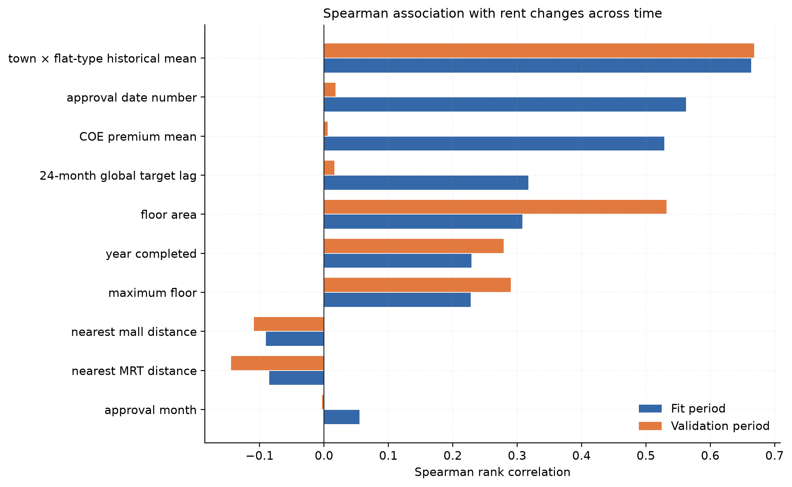
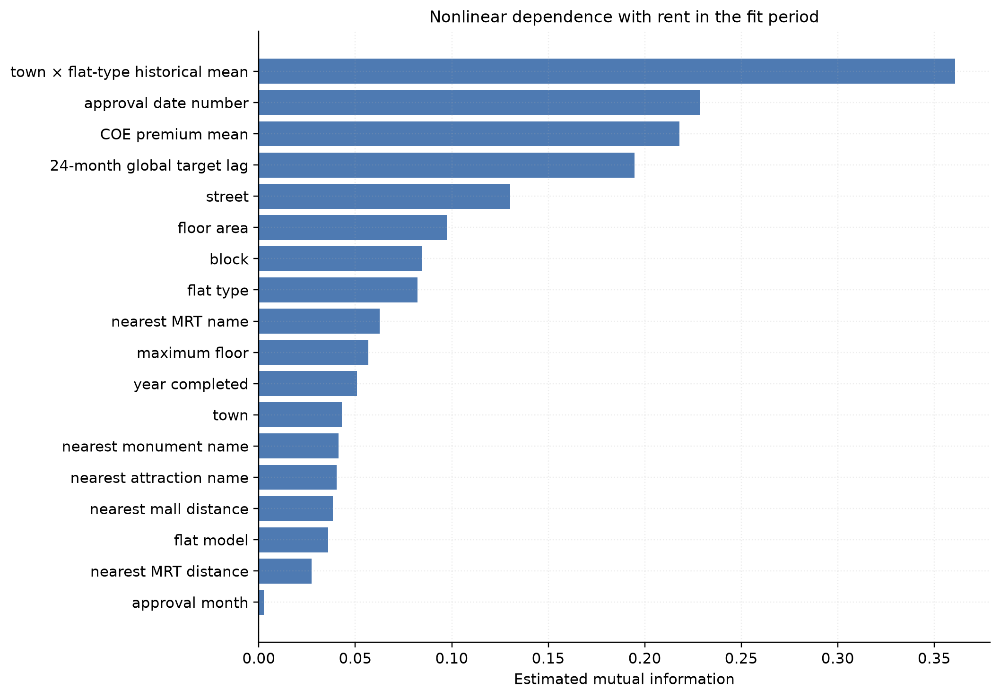
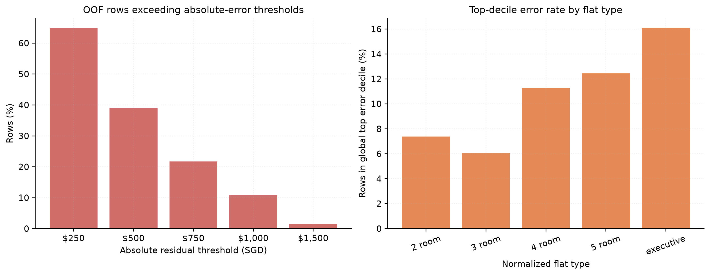

# Exploratory Data Analysis

## A. Scope and evaluation-aware methodology

This section consolidates the exploratory findings obtained from the rental data and the data-focused portions of Experiments 2–16. The objective of the analysis was not only to identify variables associated with monthly rent, but also to determine whether those relationships remain credible when predicting a later time period. Consequently, associations were inspected both on the full labelled data and on a chronological development split. The common split contains 117,988 fitting rows dated before May 2024 and 32,012 validation rows dated from May 2024 onward. No validation or test targets were used to construct historical target features.

The experiments use 150,000 labelled rental records and 50,000 test records. The labelled data run from January 2021 to March 2025, while the test horizon runs from March 2025 to July 2026. These dataset dimensions and ranges were already recorded in the project progress report and experiment setup cells.

## B. Temporal regime and validation design

The early correlation experiments found that `approval_date_num` (Pearson correlation 0.535), approval year (0.517), and mean COE premium (0.511) were among the strongest numeric associations with rent. The experiments interpreted these variables as partially capturing the same rising market regime. This finding motivated chronological validation because a random partition mixes time periods and can overstate the reliability of temporal predictors.

## C. Property structure and geographic heterogeneity

Earlier full-period exploration found that numeric flat type and floor area were associated with rent, with Pearson correlations of approximately 0.345 and 0.329. Maximum floor had a correlation of approximately 0.292. Lease commencement and derived lease age were almost perfectly redundant (correlation approximately −0.995), while approval year and sequential approval month were similarly redundant (approximately 0.973). These results motivated retaining compact representatives instead of including every related variable.

The geographic experiments showed that town, street, and block contain useful locality information. The `feature_relations` notebook also found that adding geographic categories improved its exploratory LightGBM cross-validation results. Model scores from that notebook will be documented in the modelling report rather than treated as EDA evidence here.

Accessibility effects were smaller but directionally plausible. Earlier analysis found correlations of approximately −0.085 for nearest-MRT distance, −0.083 for nearest-mall distance, and 0.100 for the number of MRT stations within 2 km. The negative signs indicate higher rents nearer to MRT stations and malls, but the small magnitudes show that accessibility alone explains little of the listing-level variation.

## D. Categorical consistency and test coverage

Several apparent categories were formatting variants rather than distinct concepts. Lowercasing, trimming, collapsing whitespace, and replacing hyphen, underscore, and slash separators with spaces reduced `STREET` from 1,146 to 576 values and `FLAT_TYPE` from 11 to 6 values in the labelled data. For example, `4-room` and `4 room` became the same category. `TOWN`, `BLOCK`, and `FLAT_MODEL` cardinalities were not reduced by this rule.

**Table I. Categorical cardinality before and after normalization**

| Field | Train raw | Train normalized | Test raw | Test normalized |
| --- | ---: | ---: | ---: | ---: |
| `TOWN` | 26 | 26 | 26 | 26 |
| `BLOCK` | 2,720 | 2,720 | 2,660 | 2,660 |
| `STREET` | 1,146 | 576 | 1,129 | 573 |
| `FLAT_TYPE` | 11 | 6 | 6 | 6 |
| `FLAT_MODEL` | 20 | 20 | 19 | 19 |

Coverage of the cleaned test categories is high. The cleaning experiment found that every test town, street, flat type, and flat model appears in training. Eleven block labels are unseen, but they affect only 36 of 50,000 test rows (0.072%). This supports native unknown-category handling and fitted geographic fallbacks; it does not justify discarding these rare test rows.

Two supplied columns carry no predictive variation: `FURNISHED` is always `yes` and `FEE` is always zero in training. They were removed in subsequent experiments.

## E. Linear, rank, and nonlinear associations

Experiment 13 repeated association analysis on the 18-feature Experiment 9 set, separating the chronological fitting and validation periods. Figure 1 shows a central result: the prior-only town × flat-type mean is both strong and stable, whereas calendar and market proxies lose nearly all marginal rank association inside the later validation regime. Floor area becomes more strongly associated with rent in validation.

**Fig. 1.** Spearman correlation with rent in the fitting and chronological validation periods. Historical target features were fitted on permitted earlier labels only.

**Table II. Numeric feature association and temporal stability**

| Feature | Fit Spearman | Validation Spearman | Absolute change |
| --- | ---: | ---: | ---: |
| Town × flat-type historical mean | 0.664 | 0.668 | 0.005 |
| Approval date number | 0.562 | 0.018 | 0.544 |
| Mean COE quota premium | 0.528 | 0.006 | 0.523 |
| Global 24-month target lag | 0.318 | 0.016 | 0.301 |
| Floor area | 0.308 | 0.532 | 0.224 |
| Year completed | 0.229 | 0.279 | 0.050 |
| Maximum floor | 0.228 | 0.290 | 0.062 |
| Nearest mall distance | −0.090 | −0.109 | 0.019 |
| Nearest MRT distance | −0.085 | −0.144 | 0.059 |

The collapse in within-validation correlation does not mean that time is irrelevant. Rather, it shows that a variable may explain the long-run shift between periods without ranking listings well inside a narrower future period. This is precisely the failure mode that a random split would conceal.

Mutual information was estimated on a 30,000-row sample of the fitting period to detect nonlinear or non-monotonic dependence. The historical town × flat-type mean ranked first (0.361), followed by approval date (0.229), COE premium (0.218), and the 24-month global lag (0.195). Street (0.130), floor area (0.098), block (0.085), and flat type (0.082) were the strongest remaining listing-level variables. Nearest-place names carried modest information, suggesting that they serve as categorical geographic proxies rather than dominant predictors.

**Fig. 2.** Estimated mutual information with rent on the fitting-period sample. Mutual information has no direction; its values should be read as a ranking of dependence rather than an effect size.

## F. Dimensionality analysis

Principal-component and truncated-SVD analyses did not reveal a single lower-dimensional representation that was both stronger and more stable than the original variables. For standardized numeric features, the first principal component explained 27.3% of variance and correlated 0.654 with the fitting target, but only 0.306 with the validation target. The second component explained 15.9% of variance; its target correlation moved from 0.262 in fitting to 0.560 in validation. SVD over the complete encoded feature space exhibited the same shift: its first component mixed approval date, COE premium, historical group mean, and target lag, and its target correlation fell from 0.669 to 0.349.

These results show that the dominant covariance directions changed across market regimes. PCA and SVD are unsupervised and maximize input variance rather than predictive stability, so the experiments retained interpretable original features and allowed nonlinear models to learn their interactions.

## G. External resale-market evidence

Experiment 14 examined 242,537 HDB resale transactions dated from January 2017 to October 2026. For each rental row, only resale transactions from earlier months were permitted. Four historical variables were derived: block median resale price per square metre, street median resale price per square metre, town × flat-type median resale price per square metre, and 12-month resale-price growth.

The first three variables had moderate positive validation correlations with rent: 0.265 at block level, 0.257 at street level, and 0.249 at town × flat-type level. The 12-month growth variable was much weaker at 0.050. Hierarchical fitted fallbacks produced no missing values in either the fitting or validation matrices. These findings indicate that the resale level contains location and property-quality information relevant to rent, while short-run resale growth contributes less direct listing-level signal. Whether that association improves validation RMSE is a feature-engineering result and will be reported separately in `data_processing.md`.

## H. Outliers and model-dependent error structure

The IQR rule flagged 130 floor-area records outside 5–173 m² and 752 rent records outside SGD 450–4,850. These observations were retained. Large HDB units and high rents can be genuine cases, and the test data may contain comparable properties; removing them solely because they are rare would narrow the prediction domain.

Experiment 15 extended EDA to out-of-fold residuals produced within the pre-May-2024 fitting period. Across 86,423 time-ordered OOF predictions, the median absolute residual was SGD 381, the 90th percentile was SGD 1,024, and 10.76% of rows had an absolute error of at least SGD 1,000. The mean signed residual, defined as actual minus prediction, was +SGD 217, indicating systematic underforecasting in those rolling folds. The OOF RMSE of SGD 612.475 belongs to this internal diagnostic construction and must not be compared directly with final holdout RMSE values.

**Fig. 3.** Model-dependent residual diagnostics from Experiment 15. “Top-decile” is defined globally using an absolute-residual threshold of SGD 1,023.83.

Error was not uniform across property segments. Executive flats had an OOF RMSE of SGD 720 and placed 16.1% of their rows in the global top error decile; five-room flats had RMSE SGD 653 and a 12.4% top-decile rate; three-room flats were easier at RMSE SGD 542 and 6.0%. Among towns with adequate sample sizes, Bukit Timah had the highest reported RMSE (SGD 807 over 256 OOF rows). Floor area and year completed were the two strongest positive permutation-importance variables in a separate diagnostic model of absolute error. These patterns motivated later segmentation and residual-modelling experiments, while also warning that small-group error estimates have high uncertainty.

## I. Consolidated findings and implications

The EDA supports six conclusions for the subsequent modelling stages:

1. **The task is temporally shifted.** Rent rose substantially across the labelled period, and the test horizon extends 17 months beyond its starting boundary. Chronological evaluation is therefore essential.
2. **Structural and local context dominate listing differentiation.** Floor area, flat type/model, town, street, block, building age, and building height contain persistent information.
3. **Historical group level is the most stable engineered signal.** The leakage-safe town × flat-type mean retained a Spearman correlation of approximately 0.66 in both fitting and validation periods.
4. **Calendar proxies require cautious interpretation.** Approval date, COE premium, and global lag are highly associated across the full history but weak at ranking rows within the later validation regime.
5. **High-cardinality geography should be preserved.** Cleaned categories have near-complete test coverage, and street/block identifiers carry nonlinear information that would be lost through aggressive aggregation.
6. **Prediction difficulty is heterogeneous.** Larger and less common property segments exhibit heavier residual tails, providing a data-based rationale for the later segmented and residual-stack experiments.

## J. Evidence traceability

The main evidence was consolidated from the following project artifacts:

- [`feature_relations.ipynb`](../../exploration/metul/feature_relations.ipynb): early correlation, geographic, native-category, and LightGBM exploration;
- [`exp_7_feature_cleaning_exploration.ipynb`](../../exploration/metul/exp_7_feature_cleaning_exploration.ipynb): category normalization and raw/clean cardinalities;
- [`exp_13_feature_space_analysis.ipynb`](../../exploration/metul/exp_13_feature_space_analysis.ipynb): fit-versus-validation correlations, mutual information, PCA, and SVD;
- [`exp_14_resale_features_lgbm.ipynb`](../../exploration/metul/exp_14_resale_features_lgbm.ipynb): historical resale coverage and associations;
- [`exp_15_residual_exploration.ipynb`](../../exploration/metul/exp_15_residual_exploration.ipynb): out-of-fold residual distributions and high-error segments; and
- [`preprocessing.py`](../../exploration/metul/preprocessing.py): shared category normalization and fitted auxiliary-data fallbacks.

The figures in this document are reproducible with [`generate_eda_figures.py`](generate_eda_figures.py).
