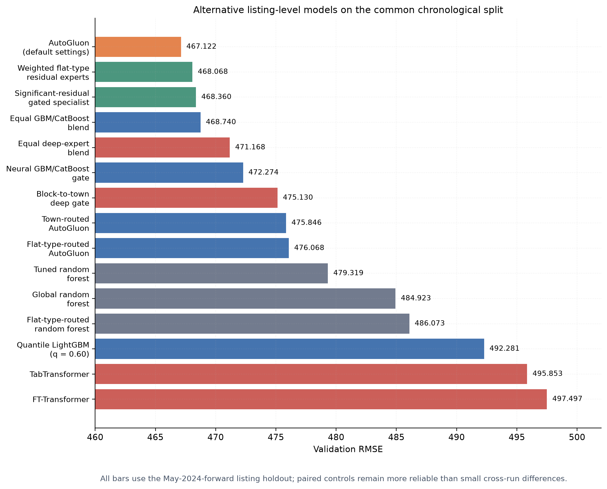
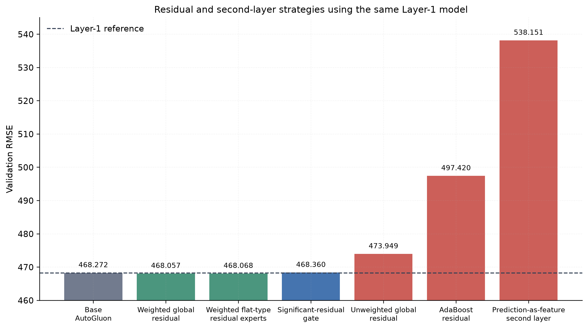

# Model Experiments and Validation Results

## A. Scope and evaluation protocol

This section compiles the modelling approaches implemented from Experiment 2 through Experiment 16. The principal result is listing-level monthly rent, evaluated by root mean squared error (RMSE), where lower values are better. When available, the main comparison uses the common chronological holdout: 117,988 rows before May 2024 for fitting and 32,012 rows from May 2024 onward for validation.

Sharing a holdout does not make every run a perfect controlled comparison. Feature sets, AutoGluon time limits, hyperparameter searches, and text-feature settings changed during development. In particular, Experiment 7 used 25 HPO trials for each of LightGBM and CatBoost and supplied the reported validation period as `tuning_data`; its RMSE is therefore an HPO-selected score, not a default-model result on an untouched holdout. Consequently, the strongest conclusions below come from paired variants inside the same notebook. Results based on older cutoffs, rolling origins, random folds, or town × flat-type segment-month targets are reported separately.

## B. Model families evaluated

The project tested the following distinct model families:

- **LightGBM:** histogram-based gradient-boosted decision trees. It was used both directly and through AutoGluon, and was effective for nonlinear interactions among property, time, location, and market variables.
- **CatBoost:** gradient boosting with native handling of categorical variables. It was often the strongest individual tree model and received most of the weight in several learned ensembles.
- **AutoGluon weighted ensemble:** a controlled wrapper around LightGBM and CatBoost in the later experiments. Its second-level model learns global blend weights from validation predictions; it is not the neural, input-dependent gate explored later.
- **Random forest and Extra Trees:** bagged tree ensembles used as structurally different experts. Random forest was also trained separately by flat type and tuned with chronological cross-validation.
- **AdaBoost:** a sequential boosting model tested as a predictor of the first AutoGluon layer's residuals.
- **Ridge trend models:** linear global and town × flat-type time trends, followed by a nonlinear residual model.
- **Classical and tabular time-series models:** ETS, Theta, recursive/direct tabular forecasts, and property- or market-segment ensembles.
- **Temporal Fusion Transformer (TFT):** a sequence model for town × flat-type monthly mean rent, later combined with a listing-level residual model.
- **TabTransformer and FT-Transformer:** deep tabular networks that embed categorical inputs and use self-attention to model interactions.
- **Multilayer perceptrons (MLPs):** dense neural experts trained on normalized numeric inputs and categorical embeddings.
- **Mixture of experts (MoE):** multiple base models combined by a neural softmax gate whose weights vary by block, with town as the fallback for unseen blocks.
- **Segmented models:** independent predictors fitted by flat type or town, with a global model as fallback.
- **Residual stacks:** later models predict errors from an earlier AutoGluon layer; a tuned correction weight controls how much of each predicted residual is added.

## C. Listing-level results on the common chronological split

Table I collects representative executed results that use the May-2024-forward listing holdout. It includes the control model where a routed or stacked experiment supplied one. The values remain approximate cross-experiment comparisons for the reasons stated above.

**Table I. Representative common-split listing-level results**

| Experiment | Model | RMSE | MAE | R² | Main observation |
| --- | --- | ---: | ---: | ---: | --- |
| Exp. 7 | HPO broad-feature AutoGluon LightGBM + CatBoost | **466.432** | 345.732 | 0.4960 | Lowest numerical score, but selected by 50 HPO trials against the same validation period and not a default-setting comparison. |
| Exp. 9 | Default/fixed-setting 18-feature AutoGluon ensemble | **467.122** | **340.293** | 0.4945 | Best result without explicit model HPO and the preferred reproducible single-stage configuration. |
| Exp. 14 | Weighted AutoGluon residual correction | 468.057 | 339.430 | 0.4925 | Improved its own 468.272 Layer-1 control by 0.215 RMSE. |
| Exp. 15 | Weighted flat-type residual experts | 468.068 | 339.893 | 0.4924 | Nearly matched the global weighted residual correction. |
| Exp. 14/15 control | AutoGluon Layer 1 | 468.272 | 340.987 | 0.4920 | Control for the later residual experiments. |
| Exp. 15 | Significant-residual gated specialist | 468.360 | 340.929 | 0.4918 | The gate did not improve its Layer-1 control. |
| Exp. 10 | Equal LightGBM/CatBoost blend | 468.740 | 341.413 | 0.4910 | Beat both individual experts and the neural gate in the same run. |
| Exp. 5 | Broad shared-preprocessor AutoGluon ensemble | 469.234 | 348.510 | 0.4899 | Established the first strong common-split ensemble baseline. |
| Exp. 12 | Equal blend of three deep experts | 471.168 | 340.981 | — | Best deep-learning MoE result; a fixed average beat the learned gate. |
| Exp. 11 | Global AutoGluon control for flat-type routing | 471.448 | 345.420 | 0.4851 | Beat the corresponding routed model. |
| Exp. 10 | Neural LightGBM/CatBoost soft gate | 472.274 | 341.839 | 0.4833 | Learned mean weights of 0.207 for LightGBM and 0.793 for CatBoost, but underperformed the equal blend. |
| Exp. 12 | Block→town deep-learning gate | 475.130 | 343.592 | — | Underperformed the equal deep-expert blend by 3.962 RMSE. |
| Exp. 11 | Town-routed AutoGluon | 475.846 | 350.586 | 0.4754 | Worse than its global control by 7.574 RMSE. |
| Exp. 11 | Flat-type-routed AutoGluon | 476.068 | 352.307 | 0.4749 | Worse than its 471.448 global control by 4.620 RMSE. |
| Exp. 13 | Chronologically tuned random forest | 479.319 | 350.676 | 0.4677 | Tuning improved the random-forest family, but it remained behind boosting. |
| Exp. 12 | Ordinary LightGBM in quantile comparison | 478.370 | 356.438 | 0.4698 | RMSE-trained reference for the asymmetric-loss experiment. |
| Exp. 12 | Global random forest | 484.923 | 354.787 | 0.4552 | Better than flat-type routing, but worse than boosted trees. |
| Exp. 12 | Flat-type-routed random forest | 486.073 | 357.987 | 0.4526 | Segmentation did not offset the loss of data per model. |
| Exp. 12 | Quantile LightGBM, q = 0.60 | 492.281 | 343.087 | 0.4386 | Shifted predictions toward overforecasting at a substantial RMSE cost. |
| Exp. 10 | TabTransformer | 495.853 | 351.220 | 0.4304 | Best standalone deep tabular network in the Experiment 10 series. |
| Exp. 14 | AutoGluon + AdaBoost residual | 497.420 | 386.768 | 0.4268 | Residual correction was too aggressive and degraded the base prediction. |
| Exp. 10 | FT-Transformer | 497.497 | 361.312 | 0.4266 | Close to TabTransformer but did not beat it. |
| Exp. 10 | Neural trend + residual decomposition | 518.590 | 369.970 | 0.3769 | Explicit trend decomposition was weaker than direct deep prediction. |
| Exp. 13 | AutoGluon prediction used as a second-layer feature | 538.151 | 387.431 | 0.3291 | Severe degradation caused by training-distribution mismatch and redundant re-learning. |

**Fig. 1.** Representative listing-level model results on the common chronological split. Training budgets and feature-generation settings changed across experiments, so paired notebook comparisons carry more evidential weight than small cross-experiment differences.

## D. Gradient boosting and AutoGluon baselines

The earliest tuned LightGBM runs established that tree boosting was appropriate for the mixture of nonlinear continuous effects and high-cardinality location categories. Experiment 2 achieved RMSE 478.603 on an older fixed holdout, while Experiment 4's correlation-selected, Optuna-tuned LightGBM achieved RMSE 481.076, MAE 362.906, and R² 0.5887 on another earlier holdout.

On the standardized chronological split, the LightGBM + CatBoost AutoGluon ensemble scored 469.234 in Experiment 5. Experiment 7 reached 466.432 after categorical cleaning and HPO, using 25 random trials per model family and the reported validation period for selection. The compact 13-feature default-setting model scored 467.230. Experiment 9's active 18-feature default-setting model scored 467.122, with its principal gain appearing in MAE rather than RMSE. The archived 17-month-lag version scored 466.992, but the active implementation uses a 24-month lag to represent a two-year history.

These experiments established boosted trees as the most reliable model family. They require no numeric scaling, model nonlinear thresholds directly, and can exploit native categories without expanding block and street into a very large one-hot matrix.

## E. Deep tabular models

Experiment 10 tested deep learning without a tree model. The TabTransformer embedded the categorical fields and applied transformer layers to their interactions while normalizing continuous variables. Early stopping selected epoch 3 at RMSE 495.853. The FT-Transformer tokenized both numeric and categorical variables and reached RMSE 497.497. A more structured network that first estimated a global and town × flat-type trend, then learned a listing residual, produced RMSE 518.590.

Experiment 12 next trained three differently configured deep experts: a wide MLP, a regularized MLP, and an FT-Transformer. Their individual RMSEs were 496.308, 482.871, and 476.979. The equal blend improved to 471.168, while the block→town neural gate obtained 475.130. The gate assigned mean weights of 0.351, 0.526, and 0.123, respectively; its preference for the regularized MLP did not translate into lower RMSE than simple averaging.

The deep models therefore learned meaningful signal, and ensembling helped considerably, but none beat the boosted-tree baseline. The training sample and tabular structure favoured tree boosting over the tested neural architectures.

## F. Neural gating and mixture-of-experts experiments

The first neural gate in Experiment 10 combined one LightGBM and one CatBoost expert. CatBoost alone scored 470.722, LightGBM scored 474.258, and their equal blend scored 468.740. The neural gate learned a strong global preference for CatBoost—mean weight 0.793—but finished at 472.274. A second run diversified three CatBoost experts by changing row samples, features, depth, and seed; the equal blend scored 471.101 and the neural gate 471.553. In both cases, input-dependent gating added variance without finding stable local regimes that beat fixed averaging.

Experiment 12 also tested multiple LightGBM configurations. In the earlier recorded run, the regularized expert scored 472.597, the balanced expert 481.318, and the complex expert 481.810; the equal blend scored 476.502 and the gate collapsed onto the balanced expert at 481.318. A later heterogeneous rerun mixed LightGBM, CatBoost, Extra Trees, and a trend-residual LightGBM. Its gate collapsed completely onto the trend-residual expert and produced RMSE 716.098. This rerun also contained an unstable LightGBM expert at RMSE 2291.784, making the equal blend unusable. The result demonstrates that a soft gate cannot compensate for poorly calibrated or failed experts; expert quality and comparable prediction scale must be checked before gating.

Overall, fixed weighted or equal blends were more robust than the learned gates. The gates tended to approximate one globally preferred model rather than discover reliable block-specific regimes.

## G. Data segmentation and random forests

Experiment 11 trained separate AutoGluon models by flat type and by town. Flat-type routing scored 476.068 against its global control at 471.448. Town routing scored 475.846 against a 468.272 control. The smaller per-segment training sets reduced model stability, especially for uncommon groups, and neither routing rule improved the global ensemble.

Experiment 12 repeated flat-type segmentation with random forests. The global forest achieved RMSE 484.923 and the routed forest 486.073. Experiment 13 then tuned a global forest using chronological folds and improved it to 479.319. This was a useful diversity result, but it remained roughly 12 RMSE behind the active Experiment 9 ensemble. A random-forest neural gate notebook was prepared and partly executed, but its final gate and holdout cells were not run; it is therefore excluded from the numerical comparison.

The segmentation experiments show that town and flat type are predictive features, but they are not effective hard routing variables for this dataset. A single model can share information across categories while still learning category interactions.

## H. Asymmetric loss and deliberate overforecasting

Experiment 12 compared ordinary RMSE-trained LightGBM with a quantile LightGBM at q = 0.60. The quantile objective penalized underforecasting more strongly and therefore shifted predictions upward. Its MAE improved from 356.438 to 343.087, but RMSE worsened from 478.370 to 492.281. This verifies that the objective can create the desired directional bias, but it does not improve the symmetric competition metric.

## I. Second layers and residual correction

Two different second-layer ideas were tested. Experiment 13 appended the first model's prediction as another input and retrained the same target. RMSE deteriorated from 468.272 to 538.151. The second model saw out-of-fold predictions during fitting but a refitted Layer-1 prediction at validation, and it redundantly tried to relearn the full target.

Experiment 14 instead predicted the Layer-1 residual. An unweighted AutoGluon residual addition also overcorrected, worsening RMSE to 473.949. Tuning a scalar residual weight selected 0.159928 and improved RMSE from 468.272 to 468.057. AdaBoost residual prediction was much worse at 497.420.

Experiment 15 investigated whether correction should be restricted to difficult rows or specialized by flat type. The significant-residual gate scored 468.360 and did not beat Layer 1. Weighted flat-type residual experts scored 468.068, nearly matching the weighted global residual model. Their unweighted version scored 472.509, again showing that residual predictions must be strongly shrunk.

**Table II. Controlled second-layer and residual comparison**

| Approach | RMSE | Change from Layer 1 |
| --- | ---: | ---: |
| AutoGluon Layer 1 | 468.272 | — |
| **Weighted global AutoGluon residual** | **468.057** | **−0.215** |
| Weighted flat-type residual experts | 468.068 | −0.204 |
| Significant-residual gated specialist | 468.360 | +0.088 |
| Unweighted global AutoGluon residual | 473.949 | +5.678 |
| Unweighted flat-type residual experts | 472.509 | +4.237 |
| AutoGluon + AdaBoost residual | 497.420 | +29.148 |
| Prediction-as-feature second layer | 538.151 | +69.879 |

**Fig. 2.** Residual and second-layer approaches built from the same 468.272 Layer-1 AutoGluon model. Only the shrunken global and flat-type residual corrections improved RMSE.

### Selected two-residual-layer configuration

The final Experiment 14 production path extends the weighted correction recursively and exports the prediction after two residual layers. The saved output records residual weights of 0.505861 and 0.201996 and a 50,000-row submission file. This is the project's currently selected final configuration.

However, the present notebook artifact does not retain the validation table for the two-residual-layer stage. It retains only the one-residual-layer outer-holdout result of 468.057 and the later production export. Therefore, the two-residual-layer model should be described as the **selected final submission architecture**, but no validation RMSE should be quoted for it until that evaluation cell is rerun or recovered. This distinction prevents an unsupported score from entering the paper.

## J. Time-series and aggregate-market experiments

These results use different prediction units or validation periods and must not be ranked against Table I.

**Table III. Time-series and hybrid results under alternate protocols**

| Experiment | Model and evaluation unit | Validation protocol | RMSE | MAE | R² |
| --- | --- | --- | ---: | ---: | ---: |
| Exp. 4 | Structural/time two-layer blend, listings | Final fold of earlier protocol | 538.165 | — | — |
| Exp. 5 | Property-group time-series ensemble, observed item-months | Recorded item-month evaluation | 477.592 | 367.880 | 0.3207 |
| Exp. 6 | Best town × flat-type market forecast | Segment-level trial | 273.240 | — | — |
| Exp. 6 | Market forecast + listing residual | 35,207 listing holdout rows | 486.052 | — | — |
| Exp. 7 | Direct GBM baseline | Rolling-origin listings | 567.562 | — | — |
| Exp. 7 | Ridge trend + GBM residual | Rolling-origin listings | 571.673 | — | — |
| Exp. 7 | Direct GBM baseline | Calendar-year listings | 613.928 | — | — |
| Exp. 7 | Ridge trend + GBM residual | Calendar-year listings | 606.495 | — | — |
| Exp. 9 | TFT market forecast | 1,340 observed segment-months | **258.453** | 182.479 | 0.8400 |
| Exp. 9 | Direct compact listing model | 2024-04-forward listing holdout | **471.209** | 349.000 | 0.4890 |
| Exp. 9 | TFT + listing residual hybrid | Same 2024-04-forward holdout | 499.791 | 391.545 | 0.4250 |

The TFT was effective at forecasting aggregate segment means, but that signal did not translate into better individual-listing forecasts. The validation-selected blend weight for the TFT hybrid was zero. Sparse fine-grained series, aggregation error, and error compounding between the market and listing stages explain why direct tabular models remained preferable.

## K. Best observed results and final interpretation

The model evidence supports four conclusions:

1. **Lowest HPO-selected common-split score:** the broad Experiment 7 AutoGluon ensemble at RMSE 466.432. It used 50 total HPO trials, automatic text expansion, and the reported validation period as HPO `tuning_data`; it should not be presented as the best default model or as an untouched generalization estimate.
2. **Best result with default/fixed model settings:** the Experiment 9 18-feature LightGBM + CatBoost ensemble at RMSE 467.122, MAE 340.293, and R² 0.4945. It uses the explicit 24-month global lag, disables automatic text expansion, and is the project's best model so far when explicit HPO runs are excluded.
3. **Best retained result within the later residual-stack protocol:** the weighted one-residual-layer AutoGluon stack at RMSE 468.057, improving its own 468.272 control. The gain is small and depends on tuning the residual weight; unweighted correction is harmful.
4. **Selected final submission architecture:** the Experiment 14 AutoGluon base plus two weighted AutoGluon residual layers. Its export and weights are preserved, but its exact validation RMSE is not present in the saved notebook output and must not be invented.

Across model families, global boosted-tree ensembles were consistently more accurate than hard segmentation, random forests, standalone deep networks, explicit trend decompositions, and neural gates. The successful residual results further indicate that later models should make small, regularized corrections rather than replace or freely re-fit the strong first-layer prediction.

## L. Evidence traceability

- [`metul_progress_report.md`](../../exploration/metul_progress_report.md): executed results through Experiment 9 and alternate-protocol time-series comparisons;
- [`exp_10_gated_gbm.ipynb`](../../exploration/metul/exp_10_gated_gbm.ipynb): LightGBM/CatBoost gates and diverse CatBoost experts;
- [`exp_10_dl_tabtransformer.ipynb`](../../exploration/metul/exp_10_dl_tabtransformer.ipynb), [`exp_10_ft_transformer.ipynb`](../../exploration/metul/exp_10_ft_transformer.ipynb), and [`exp_10_dl_trend_residual.ipynb`](../../exploration/metul/exp_10_dl_trend_residual.ipynb): standalone deep models;
- [`exp_11_flat_type_segmented_models.ipynb`](../../exploration/metul/exp_11_flat_type_segmented_models.ipynb) and [`exp_11_town_segmented_models.ipynb`](../../exploration/metul/exp_11_town_segmented_models.ipynb): segmented AutoGluon models;
- [`exp_12_random_forest_flat_type_segments.ipynb`](../../exploration/metul/exp_12_random_forest_flat_type_segments.ipynb), [`exp_12_lgbm_quantile_overforecast.ipynb`](../../exploration/metul/exp_12_lgbm_quantile_overforecast.ipynb), [`exp_12_moe_dl.ipynb`](../../exploration/metul/exp_12_moe_dl.ipynb), and [`exp_12_moe_lgbm_block_town_gate.ipynb`](../../exploration/metul/exp_12_moe_lgbm_block_town_gate.ipynb): random forest, asymmetric loss, and MoE experiments;
- [`exp_13_random_forest_hpt_target_features.ipynb`](../../exploration/metul/exp_13_random_forest_hpt_target_features.ipynb) and [`exp_13_two_layer_autogluon_stack.ipynb`](../../exploration/metul/exp_13_two_layer_autogluon_stack.ipynb): tuned random forest and prediction-as-feature stacking;
- [`exp_14_autogluon_adaboost_residual_stack.ipynb`](../../exploration/metul/exp_14_autogluon_adaboost_residual_stack.ipynb) and [`exp_14_autogluon_autogluon_residual_stack.ipynb`](../../exploration/metul/exp_14_autogluon_autogluon_residual_stack.ipynb): residual stacks and final export; and
- [`exp_15_significant_residual_gate.ipynb`](../../exploration/metul/exp_15_significant_residual_gate.ipynb) and [`exp_15_flat_type_segmented_residual_autogluon.ipynb`](../../exploration/metul/exp_15_flat_type_segmented_residual_autogluon.ipynb): gated and segmented residual correction.

The figures in this document can be regenerated with [`generate_model_experiment_figures.py`](generate_model_experiment_figures.py).
